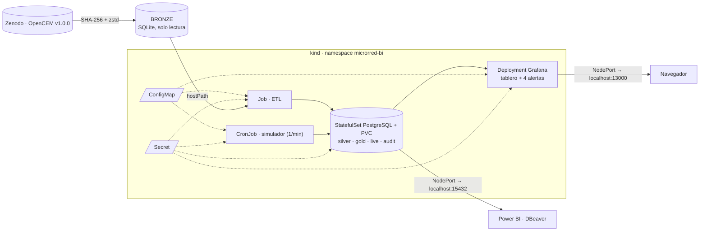

# Taller 6 · BI contenerizado y orquestado para una microrred híbrida

**Inteligencia de Negocios · 2026-II · Institución Universitaria Pascual Bravo**
Integrantes: Samuel Alfonso Avendaño · Juan Andrés Usuga Serna — Docente: Ramiro Grisales Montoya

> *From inverter telemetry to actionable insights: a containerized, Kubernetes-orchestrated BI
> pipeline for a hybrid microgrid.*

Solución de extremo a extremo que lleva la telemetría real de una microrred híbrida (solar + batería
+ red) a un modelo dimensional en PostgreSQL y la consume en dos capas: un tablero **operativo** en
Grafana, con alertas, y un tablero **analítico** en Power BI. Todos los servicios de servidor corren
en contenedores sobre un clúster local de Kubernetes y se levantan con un solo comando.

## Arquitectura



| Capa | Contenido |
| --- | --- |
| **Bronze** | `opencem-v1.0.0.sqlite` tal como se publica; nunca se modifica ni se sube a Git |
| **Silver** | Lecturas limpias agregadas a 5 minutos, eventos, contexto JSON minimizado, efecto de cada regla de calidad |
| **Gold** | Estrella con tres hechos (`fact_energia_5min`, `fact_evento`, `fact_contexto`) y cinco dimensiones (`dim_inversor` es SCD tipo 2) |

## Requisitos del equipo anfitrión

| Requisito | Versión probada | Nota |
| --- | --- | --- |
| Windows 10/11 | Windows 11 | Los scripts son Bash; se ejecutan con Git Bash |
| Git para Windows (incluye Git Bash) | — | |
| Docker Desktop, en ejecución | 29.8.0 | 8 GB de RAM asignados; 2 CPU o más |
| `kubectl` | 1.36 | Viene con Docker Desktop |
| `kind` | 0.33.0 | En el `PATH` o copiado a `tools/kind.exe` (`winget install Kubernetes.kind`) |
| Python 3.11 o superior | 3.13 | Para la descarga de datos (`pip install zstandard`) y las pruebas |
| Espacio en disco | ≈ 8 GB | 4,4 GB de la base descomprimida + imágenes |
| Puertos libres en `localhost` | 15432 y 13000 | PostgreSQL y Grafana |
| Power BI Desktop y DBeaver | PBI 2.159 | Consumo y administración |

## Reproducir la solución desde cero

```bash
git clone https://github.com/samuelalfonso011-eng/solarbi-avendano-usuga.git
cd solarbi-avendano-usuga/taller6
```

```bash
bash scripts/up.sh
```

Ese comando: verifica los requisitos, **descarga y verifica los datos** si faltan, crea el clúster,
construye las imágenes y las copia al nodo, crea el Secret a partir de `.env` (lo genera con claves
aleatorias si no existe), aplica los manifiestos y espera a que PostgreSQL, Grafana y la carga
histórica terminen bien. Para eliminar todo:

```bash
bash scripts/down.sh
```

| Servicio | Dirección | Credenciales |
| --- | --- | --- |
| Grafana | <http://localhost:13000> | `GF_SECURITY_ADMIN_USER` / `GF_SECURITY_ADMIN_PASSWORD` de `.env` |
| PostgreSQL (Power BI, DBeaver) | `localhost:15432`, base `microrred` | usuario `bi_lectura`, clave `BI_PASSWORD` de `.env` |
| Power BI | abrir `powerbi/MicrorredBI.pbip` y pulsar *Actualizar ahora* | las de `bi_lectura` |

Otros comandos:

| Comando | Para qué |
| --- | --- |
| `bash scripts/aplicar_config.sh` | Aplicar un cambio de `config/microrred.env` o del tablero sin reconstruir imágenes |
| `bash scripts/etl_reejecutar.sh` | Volver a ejecutar la carga histórica (idempotente) |
| `bash scripts/demo_resiliencia.sh [postgres\|grafana\|alerta\|escalar\|rolling\|evidencia]` | Demostraciones de la sustentación |
| `bash scripts/pruebas.sh` | 29 pruebas unitarias + 12 de integración |
| `bash scripts/alertas.sh` | Estado de las reglas de alerta |
| `bash scripts/up.sh dev` | Ambiente dev (otro namespace) |
| `docker compose up -d postgres grafana simulador` y `docker compose run --rm etl` | Desarrollo local sin Kubernetes |

## Datos: de dónde se descargan y cómo se verifican

Los datos **no están en el repositorio**. Se descargan del registro oficial de Zenodo,
<https://zenodo.org/records/21436223> (OpenCEM v1.0.0, DOI 10.5281/zenodo.21436223). Solo se
necesitan cinco archivos (≈ 312 MB); las imágenes de cielo quedan fuera del alcance.

```bash
python -m pip install zstandard
```

```bash
python scripts/descargar_datos.py --destino data/bronze
```

El script descarga con reanudación, compara el **SHA-256** de cada archivo contra
`opencem-v1.0.0-SHA256SUMS.txt` y descomprime la base (equivale a
`zstd -d opencem-v1.0.0.sqlite.zst -o opencem-v1.0.0.sqlite`). Evidencia de la verificación:
`docs/evidencias/01_descarga_sha256.txt`.

| Archivo | SHA-256 |
| --- | --- |
| `opencem-v1.0.0.sqlite.zst` | `8e38f98209029367a3775799ee9a7c0757cc7e8f2742e4df4eccc45dd4b27517` |
| `opencem-v1.0.0-support.zip` | `5debdbebb82ed784e1c11ac70c81fe876400a049a001a8dc2230446e2f460439` |
| `opencem-v1.0.0.sqlite` (descomprimido) | `5fe1f213a4a6804cdfc75f6173f437772c918f45dc0f127eb7e8936c2c2d9fbb` |

## Estructura del repositorio

```
taller6/
├── README.md
├── docker-compose.yml          desarrollo local
├── .env.example                plantilla de credenciales (el .env real no se versiona)
├── config/microrred.env        parámetros no sensibles → ConfigMap
├── sql/init/                   DDL: roles, silver, gold, vistas, permisos
├── sql/consultas_negocio.sql   13 consultas (ventanas, JSON, comparativos)
├── etl/                        Dockerfile + paquete microrred_etl
├── simulador/                  Dockerfile + simular.py
├── grafana/                    tablero JSON + provisioning (fuente, tableros, alertas)
├── k8s/base/                   manifiestos + kustomization
├── k8s/overlays/{demo,dev}/    ambientes
├── powerbi/                    proyecto PBIP (TMDL + PBIR)
├── scripts/                    up, down, descarga, diagnóstico, demos, pruebas
├── tests/                      pruebas unitarias y de integración
└── docs/                       documentación por sección, evidencias, informe
```

## Documentación

| Sección del taller | Documento |
| --- | --- |
| Matriz de trazabilidad de requisitos | [docs/00_matriz_trazabilidad.md](docs/00_matriz_trazabilidad.md) |
| A. Negocio y diagnóstico de la fuente | [docs/01_negocio_y_fuente.md](docs/01_negocio_y_fuente.md) |
| B. Indicadores | [docs/02_indicadores.md](docs/02_indicadores.md) |
| C. Modelo dimensional | [docs/03_modelo_dimensional.md](docs/03_modelo_dimensional.md) |
| D. Diccionario de datos | [docs/04_diccionario_datos.md](docs/04_diccionario_datos.md) |
| E. ETL y calidad de datos | [docs/05_etl_calidad.md](docs/05_etl_calidad.md) |
| F. Base de datos | [docs/06_base_datos.md](docs/06_base_datos.md) |
| G. Power BI | [docs/07_powerbi.md](docs/07_powerbi.md) |
| H. Grafana | [docs/08_grafana.md](docs/08_grafana.md) |
| I. Arquitectura y análisis | [docs/09_arquitectura_analisis.md](docs/09_arquitectura_analisis.md) |
| J. Ética y seguridad | [docs/10_etica_seguridad.md](docs/10_etica_seguridad.md) |
| K. Docker y Kubernetes | [docs/11_kubernetes.md](docs/11_kubernetes.md) |
| Sustentación | [docs/12_sustentacion.md](docs/12_sustentacion.md) |
| Evidencias (salidas reales) | [docs/evidencias/](docs/evidencias/) |

## Resultados principales

- 2 989 759 lecturas → 178 968 intervalos de 5 minutos; **96,1 % de lecturas válidas**.
- Conciliación contra los contadores del propio inversor: carga −0,45 %, solar +1,29 %.
- ETL idempotente: dos corridas dejan la misma huella (`542622b6dbba4c989722d9e477f13576`).
- Entre el 83 % y el 85 % de la energía comprada a la red se consume de noche; autosuficiencia
  anual de 28,9 % y 30,9 %.

## Pendientes conocidos

- Power BI: el proyecto abre en Power BI Desktop, pero la primera actualización de datos exige
  escribir la contraseña de `bi_lectura`; las capturas con cifras se toman después.
- No se implementó el acceso por nombre de dominio (Ingress), que era una bonificación.
- La eficiencia de batería del inversor 1 en enero–abril de 2026 supera el 100 % por un sesgo del
  sensor de corriente (ver `docs/01_negocio_y_fuente.md`).

## Datos y licencia

Los datos se publican bajo licencia **CC BY 4.0**. Se usan sin modificar la fuente; las
transformaciones aplicadas están documentadas en `docs/05_etl_calidad.md`.

**Cita:** Bartels, T. S., Wu, R., Lu, X., Chen, Y., Lu, Y., Xia, F., Yang, H., Chen, Y., & Li, T.
(2026). *OpenCEM: Multimodal photovoltaic and battery microgrid dataset with context records and sky
imagery* (Version 1.0.0) [Dataset]. Zenodo. https://doi.org/10.5281/zenodo.21436223

Documentación científica: Bartels, T. S. et al., *Bridging Natural Language and Microgrid Dynamics:
A Context-Aware Simulator and Dataset*, arXiv:2604.05429.
Tarifa: EPM, *Tarifas y Costo de Energía Eléctrica – Mercado Regulado*, octubre de 2026.
