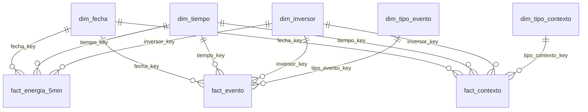

# C. Modelo dimensional

## C.1 Diseño y justificación: esquema en estrella (constelación de hechos)

Se eligió **esquema en estrella** con tres tablas de hechos que comparten dimensiones conformadas
(una *constelación*). DDL: `sql/init/02_gold_dimensional.sql`.

**Por qué estrella y no copo de nieve (*snowflake*).**

- Las dimensiones son pequeñas (813 fechas, 288 intervalos, 6 versiones de inversor, 6 tipos de
  evento, ~70 tipos de contexto): normalizarlas no ahorra espacio y sí añade *joins*.
- Power BI rinde mejor y es más fácil de usar con dimensiones desnormalizadas: una relación
  uno-a-muchos por dimensión y jerarquías dentro de la misma tabla (año > trimestre > mes > día).
- Las consultas de Grafana quedan con un solo *join* por dimensión.
- El costo de la redundancia (por ejemplo, repetir `nombre_mes` en cada fecha) es despreciable.

## C.2 Grano de cada tabla de hechos

| Hecho | Proceso de negocio | **Grano** | Filas | Medidas |
| --- | --- | --- | ---: | --- |
| `fact_energia_5min` | Flujo de energía de la microrred | **Un inversor en un intervalo de 5 minutos (hora local) con al menos una lectura cruda** | 178 968 | Energías (solar, carga, red, batería carga/descarga, red→batería), potencias máximas, SOC, segundos observados y en cada estado, lecturas crudas y válidas |
| `fact_evento` | Operación: eventos y fallas | **Un episodio de un evento operativo en un inversor** (desde que empieza hasta que termina) | 7 870 | Duración, número de lecturas, valor extremo (SOC mínimo, código de falla u horas de hueco) |
| `fact_contexto` | Uso de las cargas (contexto) | **Un registro de contexto** (un intervalo anotado por una estación, el sistema o una persona) | 25 178 | Duración, esfuerzo estimado, atributos JSON |

Son tres procesos de negocio distintos, con granos distintos, que se cruzan por las dimensiones
conformadas fecha, tiempo e inversor.

Las medidas de energía son **aditivas** en todas las dimensiones. SOC y potencias máximas son
**no aditivas** (se agregan con MIN/MAX/promedio). Los segundos observados son aditivos y permiten
recalcular la disponibilidad a cualquier nivel.

## C.3 Dimensiones, atributos y jerarquías

| Dimensión | Atributos | Jerarquías | Origen |
| --- | --- | --- | --- |
| `dim_fecha` | fecha, año, trimestre, mes, nombre del mes, año-mes, semana ISO, día, día de la semana, fin de semana, **festivo del campus**, tipo de día | Año > Trimestre > Mes > Día; Semana > Día | **Construida**: calendario generado; los festivos salen de las anotaciones manuales del contexto |
| `dim_tiempo` | hora, minuto, etiqueta HH:MM, **franja horaria**, **periodo solar**, **turno** | Franja horaria > Hora > Intervalo de 5 min | **Construida por el equipo: no existe en la fuente** |
| `dim_inversor` (SCD 2) | inversor, carga principal, prioridad de salida, prioridad de carga, SOC de batería llena, capacidad de batería, vigencia | Inversor > Versión de configuración | `settings` + artículo de los autores |
| `dim_tipo_evento` | código, nombre, categoría, severidad, cómo se detecta, si es dato inválido | Categoría > Evento | **Construida**: catálogo del equipo |
| `dim_tipo_contexto` | fuente, tipo de contexto, dispositivo, categoría | Categoría > Fuente > Tipo | Llaves del JSON + categoría asignada por el equipo |

**La dimensión construida que no existe en la fuente es `dim_tiempo`**: la fuente solo tiene un
instante Unix. Clasificar cada intervalo en *Madrugada / Mañana / Mediodía solar / Tarde / Noche*,
en *Diurno / Nocturno* y en *turno laboral* es lo que permite responder "¿a qué hora se compra la
energía?" (el 83–85 % de la compra a la red ocurre en horario nocturno).

`dim_inversor` incluye un miembro `0 = Instalación completa` para los registros de contexto que
no pertenecen a un inversor (calendario, salida y puesta del sol).

## C.4 Eventos operativos frente a lecturas

Alarmas, apagados y batería baja **no se modelan como columnas de la lectura ni se descartan como
datos inválidos**. Se modelan en un hecho propio, `fact_evento`, por tres razones:

1. **Grano distinto.** Una lectura ocurre cada ~12 s; un evento es un intervalo con principio y fin.
   Guardarlo como bandera en cada lectura obligaría a reconstruir los episodios en cada consulta.
2. **Preguntas distintas.** "¿Cuántas veces y cuántas horas estuvo la batería baja?" es un conteo de
   episodios; "¿cuánta energía se compró?" es una suma de lecturas.
3. **Trazabilidad.** Un apagado real no es un dato malo: descartarlo ocultaría justo lo que
   mantenimiento necesita ver.

Aun así, el hecho de energía conserva los **segundos en cada estado** (`seg_sin_red`,
`seg_salida_apagada`, `seg_bateria_baja`), que son aditivos y permiten calcular horas por día sin
pasar por los episodios.

| Evento | Origen en la fuente | ¿Dato inválido? | Episodios | Horas |
| --- | --- | --- | ---: | ---: |
| Red ausente / modo isla | `linevolta` < 100 V | No: evento real | 18 | 1 836,6 |
| Salida apagada | `outvolta` < 100 V | No: evento real | 401 | 403,4 |
| Batería baja | `battsoc` ≤ 15 % | No: evento real | 29 | 121,8 |
| Alarma activa | `status.sysalarmflag` con algún bit activo | No: evento real | 4 542 | 2 106,2 |
| Falla registrada | registro 00 nuevo en `fault_history` (hora calibrada por los autores) | No: evento real (instantáneo) | 2 566 | — |
| Hueco de telemetría | más de 10 min sin lecturas válidas | **Sí**: problema del registro | 314 | 3 133,4 |

## C.5 Matriz de bus

| Proceso de negocio (hecho) | Fecha | Tiempo | Inversor | Tipo de evento | Tipo de contexto |
| --- | :---: | :---: | :---: | :---: | :---: |
| Flujo de energía (`fact_energia_5min`) | X | X | X | | |
| Eventos operativos (`fact_evento`) | X | X | X | X | |
| Contexto de las cargas (`fact_contexto`) | X | X | X | | X |

## C.6 Bonificación: dimensión de cambio lento (SCD)

**`dim_inversor` es una SCD tipo 2.** La configuración del inversor cambió durante el año
(tabla `settings`):

| inversor_key | Inversor | Prioridad de salida | Prioridad de carga | SOC batería llena | Válido desde | Válido hasta |
| ---: | --- | ---: | ---: | ---: | --- | --- |
| 1 | 1 | 2 | 2 | 95 | (inicio) | 2025-08-28 |
| 2 | 1 | 0 | 2 | 100 | 2025-08-29 | 2026-01-06 |
| 3 | 1 | 0 | 3 | 100 | 2026-01-07 | (vigente) |
| 4 | 2 | 0 | 2 | 100 | (inicio) | 2026-01-06 |
| 5 | 2 | 0 | 3 | 100 | 2026-01-07 | (vigente) |

**Por qué tipo 2 y no tipo 1.** La prioridad de carga decide de dónde se carga la batería, así que
cambia el balance energético. Con tipo 1 (sobrescribir) toda la historia quedaría asociada a la
configuración actual y no se podría comparar el antes y el después. Con tipo 2 cada hecho apunta a
la versión vigente en su fecha. La consulta P9 lo aprovecha: tras el cambio del 7 de enero de 2026,
la compra a la red del inversor 2 pasó de 12,90 a 8,48 kWh/día.

Los códigos (0, 2, 3) vienen de un mapa de registros propietario que los autores no publican: se
guardan tal cual y no se les asigna un nombre que no podemos verificar. Las versiones se detectan
con la **moda diaria** de la configuración, para ignorar las lecturas copiadas del otro inversor.
