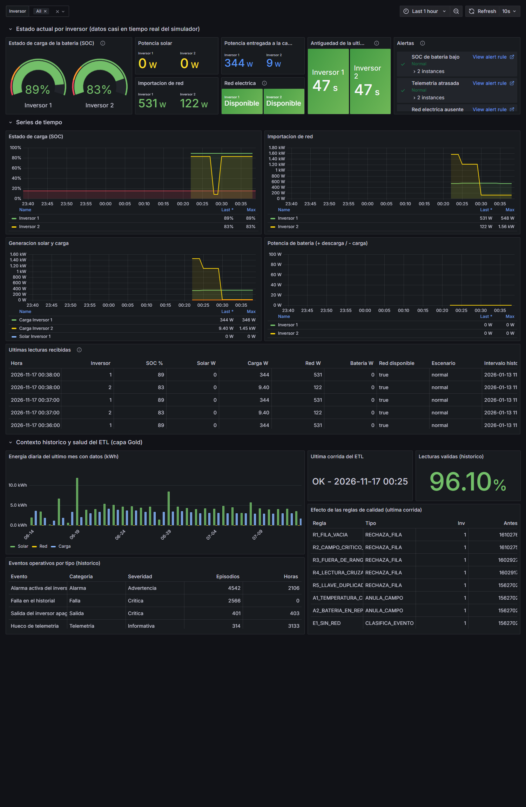
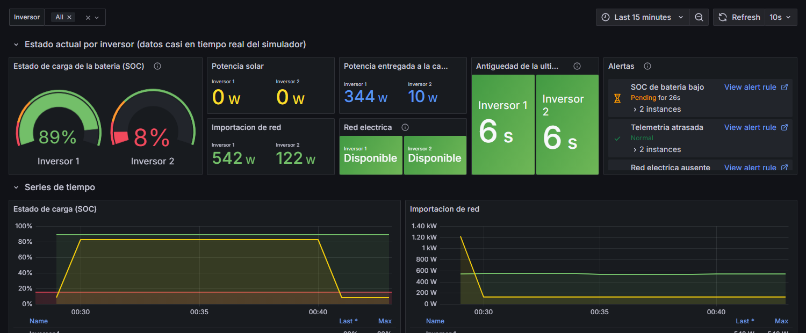

# H. Grafana

Todo llega por archivos (*provisioning*): nada se configura en la interfaz.

| Elemento | Archivo | Cómo llega al pod |
| --- | --- | --- |
| Fuente de datos PostgreSQL | `grafana/provisioning/datasources/postgres.yaml` | ConfigMap `grafana-datasources` |
| Proveedor de tableros | `grafana/provisioning/dashboards/tableros.yaml` | ConfigMap `grafana-proveedor-tableros` |
| Tablero exportado (JSON) | `grafana/dashboards/microrred_operacion.json` | ConfigMap `grafana-tableros` |
| Reglas de alerta | `grafana/provisioning/alerting/reglas.yaml` | ConfigMap `grafana-alertas` + initContainer que escribe los umbrales |

## H.1 Fuente de datos

PostgreSQL (`grafana-postgresql-datasource`), URL `postgres:5432` (nombre del Service, no IP),
base `microrred`, usuario **`grafana_ro`** (solo lectura) y contraseña desde el Secret. Marcada como
no editable desde la interfaz.

## H.2 Tablero "Microrred híbrida – Operación"



| Fila | Paneles | Tipo |
| --- | --- | --- |
| **Estado actual por inversor** | SOC, potencia solar, potencia a la carga, importación de red, estado de la red, antigüedad de la última lectura, lista de alertas | *gauge*, *stat*, *alert list* |
| **Series de tiempo** | SOC con la línea de umbral, importación de red, generación solar y carga, potencia de batería, últimas lecturas | *time series*, tabla |
| **Contexto histórico y salud del ETL** | Energía diaria del último mes con datos, última corrida del ETL, % de lecturas válidas, efecto de las reglas de calidad, eventos por tipo | *bar chart*, *stat*, tabla |

- **Variable de tablero `$inversor`**: consulta `SELECT DISTINCT inversor_id FROM gold.dim_inversor`;
  selección múltiple y opción "todos". Todos los paneles filtran con `inversor_id IN ($inversor)`.
- Actualización automática cada 10 s; ventana por defecto, la última hora.
- Las series usan el macro `$__timeFilter(ts)` sobre `live.lectura`.

## H.3 Reglas de alerta

Cuatro reglas en la carpeta *Microrred*, evaluadas cada 30 s. Cada consulta devuelve una fila por
inversor con el **margen** respecto al umbral; la alerta se dispara cuando el margen es negativo, de
modo que cada inversor es una instancia de alerta independiente.

| Regla | Condición | Umbral y justificación | Espera (`for`) |
| --- | --- | --- | --- |
| **SOC de batería bajo** | SOC actual < umbral | 15 %: ajuste de alarma del propio inversor (`batsoclowalarm`); a 5 % corta la salida | 1 min |
| **Telemetría atrasada** | segundos desde la última lectura > umbral | 300 s: cinco ciclos del simulador; mide la disponibilidad del registro en vivo. Sin datos también alerta | 1 min |
| **Red eléctrica ausente** | red no disponible | Evento operativo: modo isla | 1 min |
| **Importación de red alta** | promedio de 5 min > umbral | 3 000 W: por encima del percentil 99 histórico (1 392 W y 2 397 W) | 2 min |

**Umbrales desde el ConfigMap.** `ALERTA_SOC_BAJO_PCT`, `ALERTA_SIN_DATOS_S` y `ALERTA_RED_ALTA_W`
están en `config/microrred.env`. Grafana no interpola variables de entorno dentro de las reglas, así
que un initContainer (`grafana/render_provisioning.sh`) las escribe en la plantilla antes de que
Grafana arranque. Cambiar un umbral: editar el archivo y ejecutar `bash scripts/aplicar_config.sh`; el ConfigMap
cambia de nombre (sufijo con hash) y el Deployment de Grafana se reinicia solo. No se reconstruye
ninguna imagen ni se toca la interfaz.

No se configuró un canal de notificación externo (correo, Teams): las alertas se ven en el tablero y
en *Alerting*. Añadirlo es otro archivo de *provisioning* (`contactPoints`).

## H.4 Simulación de datos nuevos (*streaming*)

El simulador (`simulador/simular.py`) corre **dentro del clúster como CronJob**, una pasada por
minuto. No inventa valores: **reproduce intervalos históricos reales** de `gold.fact_energia_5min`
y los inserta en `live.lectura` con la hora actual. El intervalo se elige así: el día es
`SIM_DIA_BASE` (12 de enero de 2026) más el día actual módulo 7, y la hora es la hora local actual
(`America/Bogota`). Cada lectura guarda en `ts_origen` el intervalo histórico del que proviene. Los
datos simulados viven en el esquema `live` y nunca se mezclan con los hechos históricos.

Escenarios (`SIM_ESCENARIO`): `normal`, `bateria_baja` (fuerza el SOC de un inversor a 8 %) y
`sin_red` (simula un corte).

### Demostración: el tablero y la alerta reaccionan

`bash scripts/demo_resiliencia.sh alerta` (evidencia: `docs/evidencias/12_demo_alerta.txt`):

```
--- se cambia el escenario del simulador (variable de entorno, sin reconstruir la imagen)
cronjob.batch/simulador env updated
t+60s   SOC de bateria bajo   estado=pending   inv 2=Pending, inv 1=Normal
t+120s  SOC de bateria bajo   estado=firing    inv 2=Alerting, inv 1=Normal
ultima lectura: inv 2 soc=8 escenario=bateria_baja
--- se vuelve al escenario normal (valor del ConfigMap)
t+60s   SOC de bateria bajo   estado=inactive  inv 1=Normal, inv 2=Normal
```



En la sustentación se puede cambiar el escenario de dos formas, ambas sin reconstruir la imagen:
`kubectl -n microrred-bi set env cronjob/simulador SIM_ESCENARIO=bateria_baja` (inmediata y
reversible con `SIM_ESCENARIO-`), o editando `config/microrred.env` y volviendo a aplicar.
