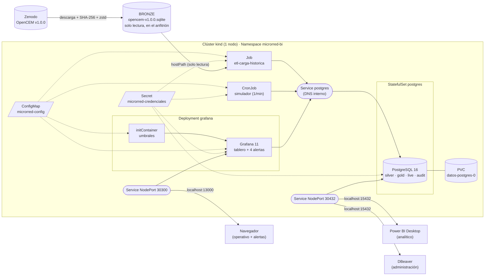
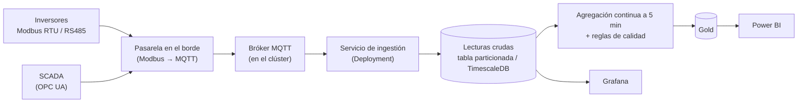

# I. Arquitectura y análisis

## I.1 Arquitectura completa, de la fuente al consumo

| Capa | Dónde vive | Qué contiene |
| --- | --- | --- |
| **Bronze** | Archivo SQLite en el anfitrión, montado en solo lectura | La fuente tal como se publicó; `bronze.ingesta` registra su SHA-256 en cada corrida |
| **Silver** | PostgreSQL, esquema `silver` | Lecturas limpias a 5 minutos, eventos, contexto minimizado, efecto de las reglas |
| **Gold** | PostgreSQL, esquema `gold` | Modelo dimensional y vistas de indicadores |
| **Tiempo real** | PostgreSQL, esquema `live` | Lecturas del simulador |
| **Consumo** | Anfitrión | Power BI (Gold), Grafana (`live` + Gold), DBeaver |

Flujo de despliegue: `scripts/up.sh` → clúster kind → imágenes al nodo → Secret → manifiestos
(Kustomize) → PostgreSQL crea el esquema → el Job carga el histórico → el CronJob alimenta `live` →
Grafana arranca con todo aprovisionado.

## I.2 Power BI frente a Grafana

| | **Power BI** | **Grafana** |
| --- | --- | --- |
| Pregunta que resuelve | ¿Qué pasó y por qué? ¿Dónde conviene invertir? (tendencias, comparaciones, escenarios) | ¿Qué está pasando ahora? ¿Algo se salió de rango? |
| Usuario | Dirección de infraestructura, analista | Mantenimiento, operador de turno |
| Horizonte | Meses, el año completo | Minutos, la última hora |
| Frecuencia de actualización | Por carga: al actualizar el modelo (diaria o por demanda); modo *Import* | Cada 10 s contra la base; alertas evaluadas cada 30 s |
| Fuente | Capa Gold (hechos y dimensiones) | `live.lectura` y vistas de Gold |
| Fortalezas | Modelo semántico con relaciones, DAX, inteligencia de tiempo, profundización por jerarquías, parámetros de escenario, exploración libre | Series de tiempo, estado actual, variables de tablero, **alertas con estados**, todo como código, funciona en un navegador |
| Debilidades | Sin alertas operativas por umbral cada pocos segundos; Desktop es de Windows y no corre en el clúster | Sin modelo semántico ni medidas reutilizables: cada panel es una consulta SQL; no hay escenarios ni exploración *ad hoc* cómoda |
| Despliegue | Aplicación de escritorio en el anfitrión | Contenedor en Kubernetes |

**Por qué no se intercambian.**

- *Grafana no reemplaza a Power BI.* Para comparar meses, cruzar tres procesos de negocio por
  dimensiones conformadas o mover la tarifa en un escenario habría que escribir y mantener una
  consulta SQL por cada combinación. La dirección no escribe SQL.
- *Power BI no reemplaza a Grafana.* En modo *Import* los datos son tan recientes como la última
  actualización; DirectQuery acerca la frescura pero no ofrece reglas de alerta con estados
  (pendiente, disparada, resuelta) evaluadas cada pocos segundos, ni se despliega como un servicio
  más del clúster. Mantenimiento necesita enterarse en un minuto, no en el informe mensual.
- Comparten la misma base y las mismas definiciones (capa Gold), así que no hay dos versiones de la
  verdad: 96,1 % de lecturas válidas aparece igual en ambos.

## I.3 Propuesta de evolución: datos directos desde los inversores (Modbus) o un SCADA

Hoy la fuente es un archivo histórico y la llegada de datos se simula. Si la telemetría llegara en
directo:

| Aspecto | Hoy | Evolución propuesta |
| --- | --- | --- |
| Adquisición | Archivo SQLite | Pasarela en el borde que lee Modbus (o cliente OPC UA contra el SCADA) y publica en MQTT; con almacenamiento local para no perder datos si se cae el enlace |
| Transporte | — | Bróker MQTT (o Kafka si crece el volumen): desacopla lectura y almacenamiento |
| Ingestión | Job por lotes | Deployment que consume el bróker y escribe en continuo; el CronJob del simulador desaparece |
| Almacenamiento crudo | No se guarda crudo en PostgreSQL | Tabla particionada por tiempo o TimescaleDB, con política de retención y compresión |
| Calidad | Reglas en el ETL por lotes | Las **mismas reglas** aplicadas en línea; la regla de lectura cruzada desaparece si cada inversor publica en su propio tópico |
| Capa Silver / Gold | Recarga completa e idempotente | Carga **incremental** por marca de agua (último intervalo cerrado) con `INSERT … ON CONFLICT`, que conserva la idempotencia |
| Alertas | Sobre datos simulados | Sobre datos reales; añadir canal de notificación y escalamiento |
| Semántica | Códigos sin catálogo | Con el mapa de registros del fabricante se nombran alarmas, fallas y prioridades |
| Indicadores | Sin PR | Añadir piranómetro y registrar la potencia nominal: se habilita el *Performance Ratio* |
| Seguridad | Red local | Modbus no tiene autenticación: segmentar la red de control, pasarela de solo lectura, TLS en MQTT y `NetworkPolicy` en el clúster |
| Operación | Un nodo local | Clúster institucional con respaldos de PostgreSQL, monitoreo del propio *pipeline* y alta disponibilidad de la base con un operador |

El modelo dimensional no cambia: el grano de 5 minutos, las dimensiones y los indicadores siguen
siendo válidos. Cambia cómo llegan los datos y la frecuencia con que se carga.
